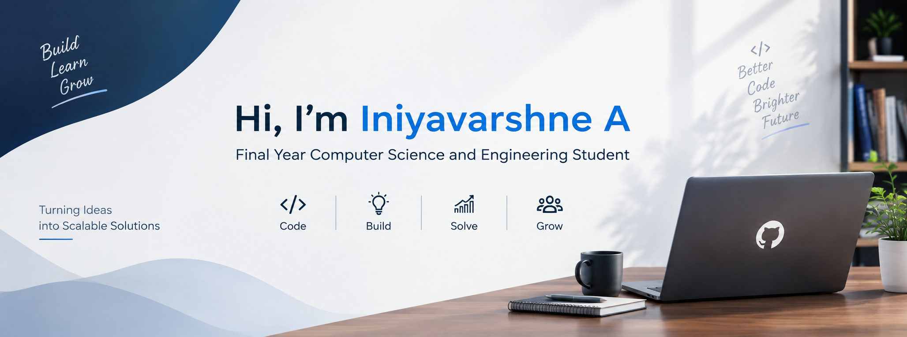

  

# Hi, I'm Iniyavarshne A👋

### Computer Science and Engineering Student

Building Technology That Creates Impact

## 👋 Hi, I'm Iniyavarshne A

I'm a final-year Computer Science and Engineering student
interested in software development and technology-driven solutions.

- 🎓 Pursuing Computer Science and Engineering
- 💻 Interested in Python, Java and web development
- 🚀 Building practical software projects
- 🌱 Continuously learning new technologies
- 🤝 Open to internship and entry-level opportunities
- ## 🛠️ Tech Stack

### Programming Languages
### Programming Languages

### Tools & Technologies

## 🚀 Featured Projects

### Smart Campus Resource Management System

A web-based application designed to manage campus resources,
generate timetables, and detect scheduling conflicts.

**Technologies:** React.js, Node.js, Express.js, MongoDB

**Features:**
- Classroom and laboratory management
- Faculty and timetable management
- Resource allocation and conflict detection
- Scheduling optimization

[View Project](YOUR_PROJECT_REPOSITORY_URL)
## 💼 Experience

### Web Development Internship / Web Developer
**Digidara technologies and private limited | 1 month**

- Describe your responsibilities.
- Mention technologies used.
- Highlight a result or project you contributed to.
## 🏆 Certifications

- Certification Name — Issuing Organization
- Certification Name — Issuing Organization
## 📊 GitHub Statistics

## 💡 What Drives Me

- Building useful software applications
- Solving real-world problems through technology
- Improving programming and problem-solving skills
- Learning new tools and development techniques

## 📫 Let's Connect

- LinkedIn: YOUR_LINKEDIN_URL
- Email: YOUR_EMAIL
